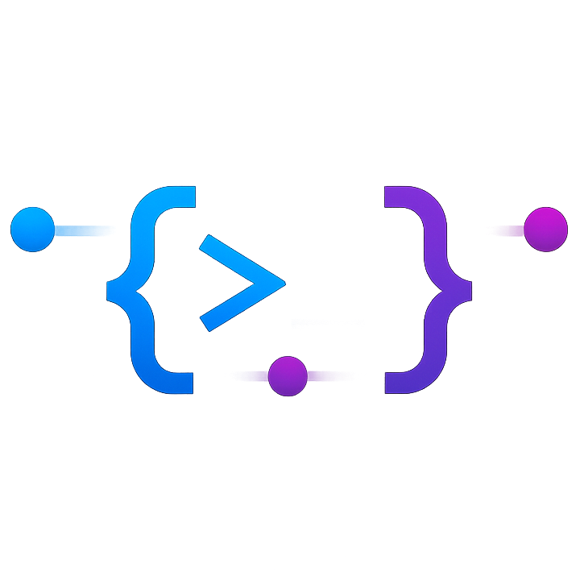

<p align="center">
  
</p>

# coding-anywhere

> Most AI coding agents run locally. **Coding Anywhere** lets you remotely
> control a development terminal — and the AI coding agents running inside it
> — from any phone or browser, without opening a single inbound port on your
> dev machine.

Priority order for agent integrations:

1. **Devin for Terminal** — first-class, ACP-native, available today.
2. Claude Code — adapter in v2.
3. Codex — adapter in v2.
4. cursor-agent — adapter in v2.

## What you get

- **Pair once, control from anywhere.** Run `coding-anywhere-daemon init`
  on your laptop, type the 6-digit code into your phone or browser, and
  you're paired forever (with refresh-token rotation in the background).
- **A live shell in your browser.** xterm.js bound to a real PTY, full
  resize, scrollback replay, multi-session sidebar.
- **A real Devin in your browser.** `devin acp` driven through the
  Agent Client Protocol, with streaming responses, tool-call cards, and
  inline permission prompts.
- **Files + diff.** Navigate the workspace, read files (CodeMirror 6),
  inspect HEAD-vs-working-tree changes side-by-side.
- **Localhost preview.** Detect listening ports, click "Open" to view
  `localhost:3000` (or anything else) through the relay — your phone can
  see your dev server with no tunnel set-up.
- **Web Push.** Get a system notification when an agent finishes a turn,
  even if the tab is in the background or your phone is asleep.

## Architecture at a glance

```
┌──────────────────┐        ┌──────────────────┐        ┌──────────────────┐
│   Client         │        │   Relay (VPS)    │        │  Dev machine     │
│   - Web (React)  │ <─wss─>│   - Go           │<─wss─> │  - daemon (Go)   │
│   - Mobile (RN)  │        │   - pairing/JWT  │        │  - PTY mux       │
│     [v3]         │        │   - routing      │        │  - Devin (ACP)   │
└──────────────────┘        │   - HTTP proxy   │        │  - files / diff  │
                            │   - Web Push     │        │  - ports + fwd   │
                            └──────────────────┘        └──────────────────┘
```

Both daemon and client connect **outbound** to the relay over WSS; the
relay only routes — it does not store conversation content.

For a deeper dive see [docs/architecture.md](docs/architecture.md).

## Repository layout

```
coding-anywhere/
├── apps/
│   ├── daemon/      Go: runs on the dev machine (subprocess of `devin acp`)
│   ├── relay/       Go: deploy via docker-compose to a small VPS
│   ├── web/         React + Vite + Mantine + CodeMirror 6 + xterm.js
│   └── mobile/      [v3] React Native (Expo), reuses packages/*
├── packages/
│   ├── protocol/    WS envelope + per-channel zod schemas
│   ├── state/       zustand stores shared by web + mobile
│   ├── tokens/      design tokens (Mantine + NativeWind)
│   ├── agents/      per-agent metadata (Devin, Claude Code, ...)
│   └── utils/       shared utilities (ulid, errors)
├── internal/        Go packages: wire / acp / agent/devin / chatrouter /
│                    terminalrouter / ptymux / fileapi / filesrouter /
│                    diffapi / diffrouter / portsapi / portsrouter /
│                    relayclient / pairingclient / auth / version
├── proto/           JSON Schemas — single source of truth for the wire
├── tools/codegen/   Generates TS + Go types from proto/
├── docker/relay/    Dockerfile + compose + Caddyfile
├── scripts/         democlient (manual smoke test) + smoke.sh
└── docs/            architecture.md, setup.md, launchd plist, systemd unit
```

## Quick start

```bash
# 1. Install deps
make install

# 2. Run web + daemon + relay together (dev mode, no TLS)
make dev

# 3. Build everything
make build

# 4. Run all tests (Go + JS)
make test
```

Web at <http://localhost:5173>. Relay listens on `:8443`. Daemon dials
the relay automatically once paired.

For a real (production-ish) install — relay on a VPS, daemon on macOS or
Linux, web client paired in your browser — see
[docs/setup.md](docs/setup.md).

## Prerequisites

- Node.js ≥ 22 (`.nvmrc` pins 22)
- pnpm ≥ 10
- Go ≥ 1.25 (required by `modernc.org/sqlite`)
- (Self-hosting) Docker + Docker Compose, plus a public DNS name and
  ports 80/443.

## Roadmap

| Phase | Scope                                                                 | Status |
| ----- | --------------------------------------------------------------------- | ------ |
| P0    | Repo scaffold, CI, codegen pipeline, Mantine UI shell                 | ✅     |
| P1    | WS envelope, device pairing, JWT, echo loop                           | ✅     |
| P2    | PTY multiplexer + xterm.js standalone terminal                        | ✅     |
| P3    | Devin for Terminal adapter via `devin acp` (chat)                     | ✅     |
| P5    | File browser + diff viewer (CodeMirror 6)                             | ✅     |
| P6    | Listening-port detection + service preview reverse proxy              | ✅     |
| P7    | VAPID Web Push when agent turns finish                                | ✅     |
| P8    | docs / launchd / systemd / docker-compose smoke                       | ✅     |
| P4+   | Tool-call schema, plan view, modes, slash typeahead, history snapshot | ✅     |
| v2    | Claude Code / Codex / cursor-agent adapters                           | future |
| v3    | React Native iOS + Android sharing `packages/*`                       | future |

## License

MIT — see `LICENSE` (added with the first tagged release).
